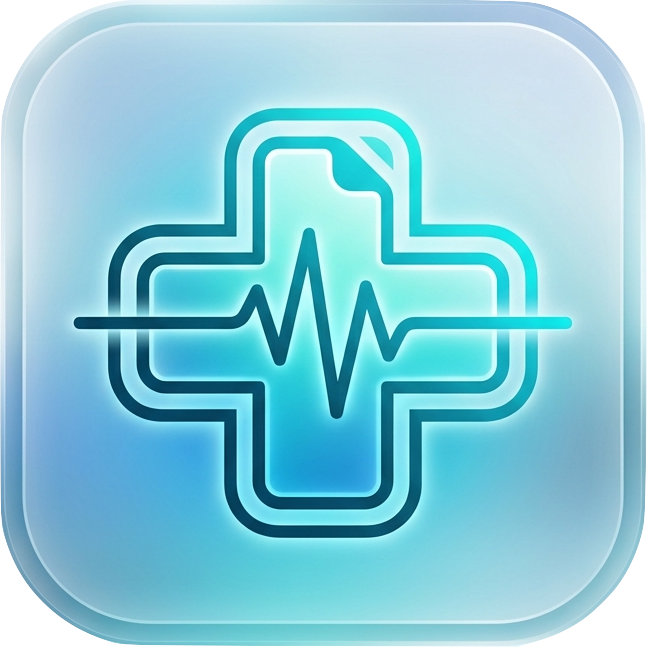

<div align="center">

  

  # 🏥 نظام سجلات وتاريخ المرضى للعيادات الطبية
  ### Clinic Patient Records Management System

  **برنامج محلي متكامل، فائق السرعة، ومحمول بالكامل يعمل بدون إنترنت (100% Offline)**  
  مصمم لإدارة العيادات والمراكز الطبية مع ربط فوري لهواتف وأجهزة العيادة عبر شبكة الواي فاي بدون أي إعدادات معقدة.

  <br />

  [](https://github.com/clinic-records/clinic-records.github.io/releases/latest)
  [](https://github.com/clinic-records/clinic-records.github.io/actions)
  [](LICENSE)
  [](#-تحميل-النسخة-الجاهزة-للعيادة)
  [](#-الأمان-والخصوصية)
  [](#-الربط-السلس-بالشبكة-المحلية-والهواتف)

</div>

---

## 📥 تحميل النسخة الجاهزة للعيادة (Direct Downloads)

> **💡 ملاحظة هامة:** كافة النسخ التالية **محمولة بالكامل (Portable)** وتعمل فوراً بنقرة واحدة دون الحاجة لتثبيت أي برامج أو متطلبات مسبقة (لا تحتاج Node.js ولا أي إعدادات سيرفر).

<div align="center">

| نظام التشغيل | المعالج / التوافق | رابط التحميل المباشر | طريقة التشغيل |
| :--- | :--- | :---: | :--- |
| **🪟 ويندوز (Windows)** | 64-bit (Windows 10 / 11) | [**⬇️ تحميل لويندوز (ZIP)**](https://github.com/clinic-records/clinic-records.github.io/releases/download/v1.0.21/ClinicRecords-v1.0.21-Windows-x64.zip) | فك الضغط وتشغيل `Clinic Records.exe` |
| **🍏 ماك (Apple Silicon)** | معالجات M1 / M2 / M3 / M4 | [**⬇️ تحميل لماك M1/M2/M3/M4 (ZIP)**](https://github.com/clinic-records/clinic-records.github.io/releases/download/v1.0.21/ClinicRecords-v1.0.21-macOS-AppleSilicon.zip) | فك الضغط وتشغيل `Clinic Records.app` |
| **🍏 ماك (Intel)** | أجهزة ماك بمعالجات إنتل | [**⬇️ تحميل لماك Intel (ZIP)**](https://github.com/clinic-records/clinic-records.github.io/releases/download/v1.0.21/ClinicRecords-v1.0.21-macOS-Intel.zip) | فك الضغط وتشغيل `Clinic Records.app` |
| **🐧 لينكس (Linux)** | كافة توزيعات 64-bit | [**⬇️ تحميل للينكس (TAR.GZ)**](https://github.com/clinic-records/clinic-records.github.io/releases/download/v1.0.21/ClinicRecords-v1.0.21-Linux-x64.tar.gz) | فك الضغط وتشغيل `./start.sh` |

<br />

[](https://github.com/clinic-records/clinic-records.github.io/releases)

</div>

---

## ⚡ خطوات التشغيل في 30 ثانية (Quick Start)

### 🪟 لمستخدمي ويندوز:
1. حمل ملف `ClinicRecords-Windows-x64.zip` من الجدول أعلاه وفك الضغط.
2. اضغط مرتين على **`Clinic Records.exe`**.
3. *إذا ظهرت نافذة الحماية الزرقاء (Windows protected your PC): اضغط على **More info** ثم **Run anyway**.*
4. سيفتح البرنامج فوراً في متصفحك الافتراضي وستظهر أيقونة البرنامج في شريط المهام بالأسفل (System Tray).

### 🍏 لمستخدمي ماك (macOS):
1. حمل الحزمة المناسبة لمعالج جهازك (Apple Silicon أو Intel) وفك الضغط.
2. افتح تطبيق **`Clinic Records.app`**.
3. *لتجاوز تنبيه الأمان عند أول تشغيل فقط:*
   - اضغط بزر الفأرة الأيمن (**Right-Click**) على التطبيق واختر **Open**.
   - اضغط على زر **Open** في الرسالة التأكيدية (أو نفذ أمر `xattr -cr "Clinic Records.app"` في Terminal).

### 📱 ربط الهاتف والتابلت عبر الواي فاي (Wi-Fi):
1. تأكد من اتصال هاتفك بنفس شبكة الواي فاي المتصل بها كمبيوتر العيادة.
2. امسح رمز الـ **QR Code** الظاهر في واجهة البرنامج بكاميرا الهاتف.
3. ستفتح واجهة السجلات على الموبايل فوراً، حيث يمكنك البحث، الاطلاع، وإضافة كشوفات وزيارات جديدة بكل سهولة.
4. يمكنك أيضاً الدخول من أي متصفح في العيادة عبر الرابط الدائم:
   ```text
   http://clinic.local:3000
   ```

---

## 🌟 مميزات المنظومة المتكاملة

### 🩺 1. ملف وسجل طبي متكامل لكل مريض
* **البيانات الشخصية والطبية:** كود ملف فريد لكل مريض (`CL-000001`)، الهاتف، الرقم القومي، النوع، تاريخ الميلاد، التشخيص الأولي، والملاحظات السريرية.
* **الصور الشخصية:** إمكانية رفع وتحديد صورة لكل مريض مع محرر وقاص دائري مدمج يدعم التكبير، التحريك، والتدوير 90 درجة.
* **المستندات الطبية الأربعة (PDF):**
  - **الملف المنفصل:** لتقارير الكشف والروشتات الخارجية.
  - **ملف البرنامج العلاجي:** للخطة العلاجية والدوائية.
  - **ملف الاختبارات والتحاليل:** لنتائج الفحوصات والأشعة.
  - **الخطة السلوكية والتأهيلية:** لمتابعة التطور السلوكي وجلسات التأهيل.
* **أرشيف تسجيلات الفيديو (Video Archive):** رفع فيديوهات عالية الدقة مع مشغل فيديو ذكي مدمج يدعم التدفق الجزئي (HTTP 206 Streaming) دون تحميل الفيديو كاملاً في الذاكرة.
* **سلة مهملات متطورة (Recycle Bin):** دعم الحذف الناعم (Soft Delete) مع استعادة فردية أو جماعية وحذف نهائي مؤمن.

### 🌐 2. العمل المشترك عبر أجهزة العيادة (Multi-Device Collaboration)
* **ربط متعدد للأجهزة:** يمكن للطبيب، والاستقبال، والتمريض استخدام البرنامج في نفس اللحظة من أجهزتهم المختلفة.
* **عداد متصلين لحظي مستقر:** معرفة عدد الأجهزة المتصلة بالنظام حالياً مع مهلة ذكية (Grace Period) تمنع وميض وتغير الرقم عند التنقل أو تحديث الصفحة.
* **تنبيهات التعارض الذكية:** ينبه النظام الطبيب فورياً في حال قيام موظف آخر بفتح أو تعديل نفس ملف المريض في الوقت نفسه.
* **نبضات اتصال دورية (Active Heartbeat):** فحص نشط كل 10 ثوانٍ لاكتشاف خروج الأجهزة أو دخول الهواتف في وضع السكون فورياً.

### 🔍 3. محرك بحث ذكي وسريع جداً (FTS5 Arabic Search)
* بحث فوري في أجزاء من الألف من الثانية حتى مع وجود ملايين السجلات.
* **تطبيع النصوص العربية تلقائياً:** يعثر على المريض فوراً مهما اختلفت طريقة كتابة الهمزات (أحمد / احمد)، التاء المربوطة (فاطمة / فاطمه)، أو الألف المقصورة (منى / مني).
* **فلاتر متقدمة:** بحث بالاسم، رقم الملف، الهاتف، النوع، تاريخ الإضافة، أو حالة وجود ملفات ومرفقات.

### 🛡️ 4. الأمان التام والنسخ الاحتياطي اللحظي
* **محلي بنسبة 100% (100% Offline):** لا يتم إرسال أي معلومة أو ملف خارج عيادتك مطلقاً.
* **نسخ احتياطي فوري بنقرة واحدة (Hot Backup):** إنشاء نسخة طبق الأصل من قاعدة البيانات دون إيقاف العمل في العيادة.
* **استعادة تأمينية:** يقوم البرنامج تلقائياً بأخذ نسخة احتياطية من البيانات الحالية قبل تطبيق أي عملية استعادة.
* **تخزين مجزأ للملفات (Sharded Storage):** تقسيم مجلدات المرضى تلقائياً لمنع تراكم آلاف المجلدات في مسار واحد وللحفاظ على سرعة نظام الملفات.

### 🔄 5. التحديث التلقائي الصامت المباشر (In-Place Auto-Update)
* فحص التحديثات الجديدة وتنزيلها وتثبيتها مباشرة من داخل التطبيق بنقرة زر واحدة عبر GitHub Releases.
* **مشغل تحديث منفصل (Detached Runner):** يغلق العمليات السابقة تلقائياً لفك قفل الملفات، ويستبدل الكود والبرامج التنفيذية في الخلفية بهدوء تام دون أي وميض لشاشات الأوامر السوداء، ثم يُعيد تشغيل التطبيق بالنسخة الجديدة تلقائياً.
* **حفظ تام لكافة البيانات:** يظل ملف قاعدة البيانات (`data/clinic.db`) وجميع المستندات والفيديوهات (`storage/`) والنسخ الاحتياطية (`backups/`) والإعدادات (`config.json`) كما هي دون أي مساس أثناء التحديث.

---

## 🏛️ المعمارية البرمجية وهيكل المشروع (Clean Enterprise Architecture)

تمت هندسة النظام وفق معايير المؤسسات الصارمة لضمان أقصى درجات الثبات والسرعة وسهولة التوسع:

```text
clinic-patient-records/
├── src/
│   ├── config.ts                    # إعدادات النظام ومسارات التخزين
│   ├── server.ts                    # نقطة الانطلاق وإعدادات خادم Fastify
│   ├── db/
│   │   ├── types.ts                 # الكيانات والنماذج البرمجية المستقلة
│   │   ├── connection.ts            # إدارة الاتصال، وإعدادات WAL والمهلة ومحرك FTS5
│   │   ├── database.ts              # الـ Facade الموحد للتنسيق بين المستودعات
│   │   └── repositories/
│   │       ├── patients.repo.ts     # مستودع بيانات وعمليات وبحث المرضى
│   │       ├── documents.repo.ts    # مستودع مستندات الـ PDF الطبية
│   │       ├── videos.repo.ts       # مستودع تسجيلات الفيديو
│   │       └── stats.repo.ts        # مستودع إحصائيات ومؤشرات النظام
│   ├── routes/
│   │   ├── api.ts                   # المنسق العام للمسارات (Route Aggregator)
│   │   ├── system.routes.ts         # مسارات SSE، الشبكة، التحديثات، والنسخ الاحتياطي
│   │   ├── patients.routes.ts       # مسارات المرضى والملفات الشخصية والصور
│   │   ├── documents.routes.ts      # مسارات رفع وتنزيل مستندات الـ PDF
│   │   ├── videos.routes.ts         # مسارات بث ورفع وحذف الفيديوهات
│   │   └── backups.routes.ts        # مسارات النسخ الاحتياطي والاستعادة الآمنة
│   └── utils/
│       ├── arabic.ts                # خوارزميات تطبيع اللغة العربية للبحث الذكي
│       ├── network.ts               # اكتشاف الـ IP وشبكة الـ LAN وتسجيل mDNS
│       ├── realtime.ts              # إدارة أحداث SSE والمتصلين واكتشاف التعارض
│       ├── storage.ts               # التخزين المجزأ وتسمية وتأمين الملفات
│       └── updater.ts               # إدارة التحديثات التلقائية وفك الضغط والمشغل المنفصل
├── scripts/
│   ├── windows-launcher/           # تطبيق الويندوز المرافق بلغة C# (System Tray & GUI)
│   ├── macos-launcher/             # تطبيق الماك المرافق بلغة Swift (Menu Bar & GUI)
│   ├── build-windows.ps1           # سكريبت بناء حزمة ويندوز المحمولة وتجميع C#
│   ├── package-macos.sh            # سكريبت بناء حزم ماك المحمولة (Universal / Apple / Intel)
│   ├── package-linux.sh            # سكريبت بناء حزمة لينكس المحمولة
│   ├── release.mjs                 # أداة النشر الآلي ومزامنة الإصدارات عالمياً
│   └── check-modules.mjs           # فاحص سلامة وحدات ES Modules
├── public/
│   ├── index.html                   # هيكل الواجهة (SPA Declarative DOM)
│   ├── app.css                      # المنسق الرئيسي للتنسيقات
│   ├── css/                         # نظام التنسيقات المجزأ (15 ملفاً مستقلاً)
│   └── js/
│       ├── state.js                 # إدارة الحالة المشتركة للواجهة
│       ├── api.js                   # عميل الاتصال بالسيرفر
│       ├── utils.js                 # دوال التنسيق ونسخ الروابط والإشعارات
│       └── modules/                 # موديولات جافاسكريبت المستقلة (Native ES Modules)
│           ├── table.js             # جدول المرضى وعمليات التحديد
│           ├── filters.js           # شريط البحث والفلاتر والتبويبات
│           ├── patient-form.js      # نموذج إضافة وتعديل المريض
│           ├── patient-details.js   # الملف التعريفي الكامل للمريض
│           ├── cropper.js           # قص وضبط وتدوير الصور
│           ├── videos.js            # رفع ومعاينة الفيديوهات
│           ├── backups.js           # إدارة النسخ الاحتياطية
│           ├── realtime.js          # أحداث الاتصال اللحظي والتعارض والتحديث
│           ├── updater.js           # واجهة شريط تقدم التحديث التلقائي
│           └── modal.js             # التحكم بالنوافذ المنبثقة
```

---

## ⚙️ ملف الإعدادات والمنافذ (`config.json`)

يتم توليد ملف `config.json` تلقائياً عند أول تشغيل بجانب التطبيق، ويمكن تخصيصه بسهولة:

```json
{
  "port": 3000,
  "host": "0.0.0.0",
  "dbPath": "./data/clinic.db",
  "storagePath": "./storage",
  "backupPath": "./backups",
  "autoOpenBrowser": true
}
```

* **تغيير منفذ الخادم:** يمكنك تعديل `"port"` إلى أي منفذ تريده (مثل 8080). علماً بأن السيرفر يبحث تلقائياً عن منفذ بديل شاغر إذا كان المنفذ 3000 مشغولاً.
* **التخزين على قرص صلب خارجي:** لنقل ملفات المرضى والفيديوهات إلى وحدة تخزين خارجية (مثل `D:\ClinicStorage`)، يكفي فقط تغيير مسار `"storagePath": "D:\\ClinicStorage"` وسيعمل البرنامج بسلاسة تامة.

---

## ❓ الأسئلة الشائعة (FAQ)

<details>
<summary><b>1. هل يحتاج البرنامج لاتصال بالإنترنت؟</b></summary>
<br />
<b>لا نهائياً.</b> البرنامج يعمل بشكل محلي بالكامل (100% Offline) داخل شبكة العيادة. الاتصال بالإنترنت يُستخدم فقط في حال رغبتك بالتحقق من التحديثات وتنزيلها بنقرة زر واحدة.
</details>

<details>
<summary><b>2. أين يتم حفظ ملفات المرضى والفيديوهات؟</b></summary>
<br />
يتم حفظ قاعدة البيانات في مجلد <code>data/clinic.db</code> والمرفقات الطبية في مجلد <code>storage/</code> بجانب البرنامج. يمكنك نقل التخزين إلى أي هارد ديسك خارجي عبر تعديل مسار <code>storagePath</code> في ملف <code>config.json</code>.
</details>

<details>
<summary><b>3. كيف أنقل البرنامج ليعمل على جهاز كمبيوتر جديد؟</b></summary>
<br />
بكل بساطة، انسخ مجلد البرنامج كاملاً (أو خذ نسخة احتياطية من واجهة البرنامج واستعدها في الجهاز الجديد) وسيعمل فوراً مع كافة السجلات والمستندات.
</details>

<details>
<summary><b>4. ماذا يحدث لو انقطعت الكهرباء أو أُغلق الكمبيوتر فجأة؟</b></summary>
<br />
قاعدة البيانات مبنية بنمط <code>WAL Mode (Write-Ahead Logging)</code> المعياري في البنوك والأنظمة الحرجة، والمضبوط بقيمة <code>busy_timeout = 10000</code>، والذي يحمي البيانات تلقائياً من أي تلف في حال انقطاع الطاقة المفاجئ أو تعارض الكتابة.
</details>

---

## 🛠️ للمطورين والتشغيل من الكود المصدري (Developer Guide)

إذا أردت تعديل الكود أو المساهمة في تطوير النظام:

### 1. المتطلبات:
* تثبيت **Node.js** (الإصدار 18 أو أحدث).

### 2. التثبيت والتشغيل:
```bash
# 1. تثبيت الحزم (تُنفذ لمرة واحدة فقط)
npm install

# 2. فحص سلامة وتوافقية الوحدات البرمجية والتايب سكريبت (في 60ms)
npm run check

# 3. تشغيل النظام في وضع التطوير الحي
npm run dev

# 4. بناء الحزمة الإنتاجية الموحدة فائقة السرعة
npm run build

# 5. تشغيل الخادم الإنتاجي
npm run prod

# 6. إطلاق إصدار جديد ومزامنة كافة المنصات والـ Tags تلقائياً
npm run release -- patch
```

### 3. بناء الحزم المحمولة للتوزيع:
```bash
# لويندوز (على جهاز ويندوز):
./scripts/build-windows.ps1

# لماك (على جهاز ماك):
./scripts/package-macos.sh

# للينكس:
./scripts/package-linux.sh
```

---

## 📜 الترخيص (License)
هذا النظام مفتوح المصدر ومتاح مجاناً للاستخدام في العيادات والمراكز الطبية الخاصة تحت ترخيص [MIT License](LICENSE).
